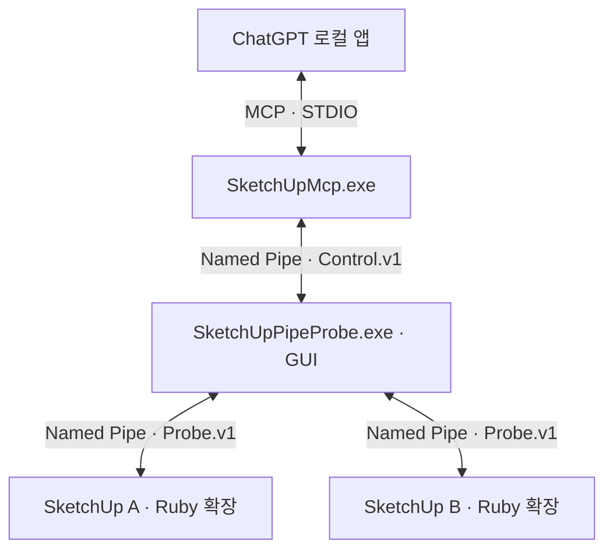

# SketchUp Local MCP Bridge 0.11.0 (시험 버전)


## 0.11.0: 전체 장면·스타일, SKP/CAD, 지형·분류

총63개 도구. 실제 SketchUp 장면의 전체2019 상태와 .style 로드/선택/확정, SKP 가져오기·복사본 저장과 Pro의3D DWG/DXF 입출력을 추가했습니다. Probe의 교체 가능한 지형 JS가 높이 격자·측량점 보간·완만한 높이 조절을 계산하며 그룹 없이 열린 표면을 그릴 수 있습니다. 분류 스키마 로드와 컴포넌트 분류·속성 변경도 지원합니다. [사용법·정확한 한계·설치 후 검사](docs/FEATURES_0.11.0.md).

자동347개 검사 통과. [검증 기록](docs/VALIDATION.md)을 따릅니다. **0.11.0 실제 SketchUp 수용 검사는 대기 중**입니다. 장면·스타일·CAD importer의2019 Undo와 파일 효과는 모델 변경의 한 번 Undo와 구분합니다. 아래0.10.0 이하는 이전 이력입니다.

## 0.10.0: 면 텍스처 편집·재질 이미지 관리·화면 프리셋

총60개 MCP 도구. Probe JS 기법으로 면별 이동·회전·축척·실제 타일 크기·기울임·4핀 배치를 계산합니다. 재질 이미지 복사/교체/제거/크기 지정, 카메라 화면 비율·초점거리, 레이어·그림자·작업축 설정 묶음 저장·적용을 추가했습니다. [범위·사용법·실기 순서](docs/FEATURES_0.10.0.md), [검증](docs/VALIDATION.md), [시험 설치](docs/TEST_RELEASE.md).

자동321개 검사 통과. **0.10.0 실제 설치 후 SketchUp 실기는 아직입니다.** 현재 사용자 앱과 모델은 교체하지 않았습니다. 아래0.9.0 이하는 이전 이력입니다.

## 0.9.0: 그룹 없는 그리기·편집과2019 공통 기능

총59개 MCP 도구. 원시 선·면을 그룹 없이 생성/편집하고, 기법에서 기존 모델 명령을 한 번에 묶어 사용할 수 있습니다. 체적·충돌·속성, 치수·문자·단면·점선, 원본 보존 Boolean·교차선·UV·개구부, 텍스처 읽기·화면 출력·그림자 설정을 추가했습니다. [정확한 지원 범위·사용법·남은 순서](docs/FEATURES_0.9.0.md), [검증](docs/VALIDATION.md), [시험 설치](docs/TEST_RELEASE.md).

**0.9.0 실제 설치 후 실기 검증은 대기 중**입니다. 새 `suite=features2019`를 준비했으며 기존 `suite=all`에는 새 검사를 넣지 않았습니다. 아래0.8.0 이하 항목은 이전 이력입니다.

Windows의 ChatGPT 로컬 앱에서 여러 SketchUp 인스턴스에 연결하는 GUI 중개 앱입니다.
모델 조회·검색, 그룹/컴포넌트·점/선/면 편집, 드로잉·리소스 관리·화면 제어를 제공합니다. 변경 명령은 SketchUp 패널의 실행 허가가 필요합니다. 실제 SketchUp에서 확인한 0.4.x 기능과 0.6.0에서 추가한 개발 검증 범위를 구분합니다. [이전 실기 결과](docs/MANUAL_RESULTS_0.4.0.md)와 아래 최신 지원 범위를 참고하세요.

## 다른 컴퓨터에서 이어가기

현재 작업 기준은 기본 브랜치 `main`입니다. 시험 배포본 설치는 [시험 배포 안내](docs/TEST_RELEASE.md), 구현·검사 이력과 환경 준비는 [작업 인계 기록](docs/HANDOFF.md)을 확인하세요.

## 0.8.0: Probe 동적 라이브러리·스크립트 엔진·선택형 패키지

- 고정7개 라이브러리 도구를 추가해 총47개. 기법 검색·작성·개선·검증·활성화·실행과 작업 기록을 Probe가 관리합니다. 외부 JavaScript를 별도 Jint 프로세스에서 계산하고 RBZ는 공통 형상 계획을 한 번의 Undo로 적용합니다.
- 작업 파일을 수정하면 재시작 없이 새 초안으로 반영합니다. 선택한 기법1개 이상을 `.probe-techpack`으로 묶고 다른 사용자/컴퓨터에서 필요한 기법과 의존성만 가져올 수 있습니다. 가져오기는 코드를 실행하거나 기존 활성본을 바꾸지 않습니다.
- 패널/두 짝 미닫이 창 예제와 스킬을 제공합니다. [라이브러리 사용 안내·구현 범위](docs/PROBE_LIBRARY_RUNTIME.md), [검토 규격](docs/PROBE_LIBRARY_SPEC.md).
- 자동 검사 **271개 통과**. 설치 ZIP은 필수5개 파일, 엔진 내장으로 Node/Python 별도 설치 불필요. **0.8.0 설치 후 실제 SketchUp 라이브러리 실행·교체·Undo 검사는 미실행**입니다. 현재 설치 프로그램과 모델은 변경하지 않았습니다.

## 0.7.0: 매개변수형 미닫이 창·재사용 스킬

- `sketchup_create_sliding_window`를 추가해 도구40개. 치수·열림·재질을 한 요청으로 받아 본틀/두 창짝/유리/매립 손잡이를 만들고 접합선을 정리합니다. 네 그룹·한 번의 Undo, 선택한 기존 창의 원자적 교체를 지원합니다.
- [창 전용 스킬](skills/sketchup-sliding-window/SKILL.md)에 기본값과 품질 규칙을 저장했습니다. [일괄 전달 방식·인수·한계](docs/WINDOW_RECIPE.md)를 참고하세요.
- 자동 검사245개 통과. 실행 중인0.6.3은 유지되며 **새0.7.0 설치 후 창 생성 native 실기는 미실행**입니다. 기존56항목 suite와 별도 확인이 필요합니다.

## 0.6.3: 해제 결과와 원시 형상 이동 판정 수정

실제0.6.2에서 확인한 해제 결과의 내부 항목/Vertex를 제외하고, 점·꼭짓점 이동의 Length 비교를 수치 비교로 바꿨습니다. 전체 개발 검사 **229개 통과**. Follow Me 수정·후속 개별 기능·batch Undo의 [실기 결과](docs/MANUAL_RESULTS_0.6.2.md)를 기록했으며, 0.6.3은 실제 SketchUp2020에서 **전체56항목 통과(실패·생략0)**와 임시 작업 복구를 확인했습니다. [최신 실기 결과](docs/MANUAL_RESULTS_0.6.3.md)를 참고하세요.

## 0.6.2: Follow Me 경로선 정리

0.6.1 실제 SketchUp 2020 검사에서 중앙 경로의 Follow Me가 실패했습니다. 새 그룹 안에서 Follow Me 후 면에 연결되지 않은 경로선을 정리한 다음 솔리드를 판정하도록 수정했습니다. 전체 개발 검사 **224개 통과**, 이 수정은0.6.2/0.6.3 실기에서 통과했습니다. [실기 결과와 남은 검사](docs/MANUAL_RESULTS_0.6.1.md)를 확인하세요. 도구 수는 39개입니다.

## 0.6.1: 대량 변경의 UI·아웃라이너 갱신 관리

- 도구39개. `sketchup_run_batch`로 최대64개 모델 변경을 한 operation/Undo에 묶습니다. 중간 단계의 실패는 전체를 취소합니다.
- 기본 `ui_updates=defer`: 중간 UI 갱신을 억제하고 commit/abort 후 화면·inspector 갱신을 각각 한 번 요청합니다. `normal`도 선택할 수 있습니다. 아웃라이너 트레이의 표시/접힘 상태는 변경하지 않습니다.
- 성공/오류/중단 모두 공통 정리 경로를 사용합니다. 완료 후 표시 오류는 형상 성공과 별도 경고로 반환해 중복 변경을 막습니다. [범위·예시·API 한계](docs/UI_UPDATES.md)를 확인하세요.
- 개발 회귀221개 통과. 실제 앱의 Outliner CPU·시간 개선은 아직 측정하지 않았습니다. 설치 ZIP은 계속 필수5개 파일입니다. 기존 일괄 실기 검사56항목은 유지하며 UI 진단을 추가로 반환합니다.

## 0.6.0: 그룹·컴포넌트·리소스·곡선·형상 편집 확장

- 도구 **38개**. 그룹 해제와 원시 형상 그룹화, 컴포넌트 변환·교체·기존 정의 배치·공유 내용 편집, 재질/태그 관리와 미사용 리소스 정리를 추가했습니다.
- 점·선·면 편집/재생성, 세 종류 호·베지어·자유곡선·다각형·다면체, 제한된 Offset·회전체·Follow Me·부드럽게·동일 평면 단순화·반전·카메라/카메라 전용 장면을 구현했습니다.
- [요청 목록 대조·제한·누락된 기본 기능](docs/EXTENDED_TOOLKIT.md)을 확인하세요. 일반 오목/구멍 Offset, 곡면 메시 감축, 전체 상태 장면, UV 편집은 아직 지원하지 않습니다.
- 일괄 검사는 `suite=core/extended/all`을 선택합니다. `all`은 **55개 기능+정리=56항목**이며, 실행 중 개별 응답을 기다리지 않습니다. 장면 변경·모델 전체 purge·개별 Undo·파일 전환은 별도 검증입니다.
- 개발 회귀 **200개 통과**. 실제 0.6.0 앱 설치 후 native 검사는 아직 미실시입니다. [검증 기록](docs/VALIDATION.md)과 [시험 배포 안내](docs/TEST_RELEASE.md)를 참고하세요. 설치 ZIP은 실행 필수 파일5개만 유지합니다.

## 0.5.0: 기본 도구와 빠른 일괄 검사 (이전 기록)

- MCP 도구 **30개**. 사각형·원·폴리라인, 회전·축척·그룹 묶기·정의 독립화·삭제·프로파일 돌출을 추가했습니다.
- 전체 배치 경로로 그룹/컴포넌트/면/선을 조회하고, 직접 형상의 모델 좌표·면적·길이와 분할 자식 경로를 읽습니다. [도구 인수와 범위](docs/BASIC_TOOLKIT.md)를 참고하세요.
- `sketchup_run_self_test`는 허가 한 번·호출 한 번으로 기능 24개와 정리를 검사합니다. 자체 임시 형상만 만들고 abort해 제거하며 선택·카메라를 복구합니다. 실패/생략·소요 시간을 보고합니다.
- [일괄 검사 스킬](skills/sketchup-self-test/SKILL.md)과 JSON 실행기를 준비했습니다. 개별 형상 단계마다 사용자 응답을 기다릴 필요가 없습니다. [실기 검사 사용법과 한계](docs/BATCH_TEST.md)를 참고하세요.
- 자동 회귀 **169개 통과**. 실제 0.5.0 앱의 신규 기능·속도는 설치 후 일괄 검사로 확인해야 합니다. 개별 Undo·파일 전환 실기는 별도이며 기존 0.4.x 실기와 구분합니다.

## 0.4.1: 모델 전환 식별 수정과 작업 지침

- 같은 Ruby Model 객체가 재사용돼도 새로 만들기·열기 알림으로 모델 ID를 갱신하고 기존 실행 허가를 회수합니다. 이전 모델 요청은 실행 전에 거부합니다.
- 전체 자동 검사 **137개 통과**. 실제 0.4.1에서도 New·같은 파일 다시 열기의 ID 갱신과 허가 회수를 확인했습니다. [실기 결과](docs/MANUAL_RESULTS_0.4.1.md)와 [원인·수정·검증 방법](docs/MODEL_IDENTITY.md)을 참고하세요.
- [SketchUp 작업 스킬](skills/sketchup-mcp/SKILL.md)에 모델 조회·변경·결과 확인과 개발 지침을 정리했습니다. 스킬은 도구나 실행 허가를 추가하는 기능이 아닙니다.
- 다음 신규 기능은 지정 객체 상세 조회 → 사각형 → 선·폴리라인 순서입니다. [단계별 범위](docs/FEATURE_PLAN.md)를 먼저 확인합니다.

## 0.4.0: 객체 생성·복제 추가

- `sketchup_create_box`: 모델 축 기준 원점과 X/Y/Z 치수를 mm로 지정해 독립 박스 그룹을 만듭니다. 변 길이는 1~1,000,000 mm입니다.
- `sketchup_duplicate_entities`: 조회한 그룹/컴포넌트를 하나씩 복제하고 모델 축 기준 mm 상대 이동을 적용합니다. 한 번에 최대 25개입니다.
- 그룹 복제본은 상위 정의를 독립화하고 컴포넌트는 원본 정의를 공유합니다. 원본을 이동하지 않으며 생성된 ID와 경로를 결과에 반환합니다.
- 두 명령 모두 로컬 허가·현재 편집 경로·명령 ID 검증, `dry_run`, 중복 실행 방지와 요청당 한 번의 Undo를 적용합니다.
- 이 기능 추가 당시 MCP 도구 **19개**, 전체 자동 검사 **124개 통과**였습니다. [인수·예시·복제 범위](docs/CREATION_COMMANDS.md)를 참고하세요.

## 0.4.0: 객체 검색·구조 탐색 추가

- `sketchup_find_entities`: 현재 편집 위치 또는 모델 전체에서 이름·정의 이름·태그·객체 종류로 그룹/컴포넌트를 찾습니다.
- `sketchup_get_children`: 루트 또는 지정한 배치 경로의 바로 아래 그룹/컴포넌트를 읽습니다. 편집 위치를 열거나 선택을 바꾸지 않습니다.
- 결과에는 영구 ID, 루트부터의 배치 경로, 현재 편집 위치 소속 여부를 포함합니다. 같은 정의의 여러 배치도 경로별로 구분합니다.
- 두 도구는 실행 허가 없이 읽기 전용으로 사용합니다. 큰 모델은 `next_cursor`로 나눠 조회하고, 깊이 제한 등으로 빠진 범위는 별도로 표시합니다.
- 검색·구조 탐색을 처음 추가했을 때 MCP 도구는 **17개**, Windows 자동 검사는 **104개 통과**였습니다. [인수·예시·조회 한계](docs/ENTITY_DISCOVERY.md)를 참고하세요.

## 0.4.0: 기초 명령 전달

- v0.3.1 이후 참조 작업본의 미커밋 변경을 가져왔습니다. MCP 도구는 기존 9개에서 15개로 늘었습니다.
- 그룹/컴포넌트를 명시한 영구 ID로 선택하거나 선택 해제하고, 위·앞·오른쪽·등각 보기 및 모델/지정 객체 확대를 요청할 수 있습니다.
- 현재 편집 위치의 그룹/컴포넌트 최대 25개에 이름·숨김·잠금·기존 태그/재질을 지정하거나 모델 축 기준 mm 상대 이동을 적용합니다. 속성·이동 명령은 요청당 하나의 Undo 작업으로 처리합니다.
- `dry_run`은 변경 없이 검증과 미리보기를 수행합니다. 미리보기와 실행에는 각각 새 명령 ID가 필요합니다.
- 명령 ID와 편집 경로를 확인하고 최근 결과 32개를 보관합니다. 중복 명령은 재실행하지 않으며, 시간 초과 시 결과를 조회합니다.
- 명령 전달을 처음 반영했을 때 Windows 자동 검사 **84개 통과**. 실제 모델 API·Undo·카메라 동작은 [수동 시험](docs/MANUAL_TEST.md)으로 확인해야 합니다.

인수·권한·결과 이력의 상세 계약은 [기초 명령 전달](docs/COMMAND_SCOPE.md), 검사 환경과 한계는 [검증 범위](docs/VALIDATION.md)에 있습니다.

## 0.3.1: 실행 파일 버전 정보와 치수 수정

- 두 EXE의 Windows **속성 → 자세히**에서 파일 버전 `0.3.1.0`, 제품 버전 `0.3.1`, 제품명·파일 설명·제작자를 확인할 수 있습니다.
- GUI 제목·MCP 초기화/상태·`--version`은 공통 `shared/BuildInfo.cs`를 사용합니다. Ruby 확장과 패널 버전은 `extension/su_pipe_probe/version.rb`를 사용합니다.
- 패키징 시 두 EXE의 실제 버전 리소스와 C#/Ruby 버전 일치를 검사합니다.
- 외곽 크기의 X/Y/Z 순서를 수정했습니다. SketchUp API에서 `height`는 Y, `depth`는 Z이므로 최소·최대 좌표 차이로 명시적으로 계산합니다.
- 설치 ZIP은 계속 실행 파일 2개·설정 파일 2개·RBZ 1개만 포함합니다.

## 0.3.0: 모델 정보 읽기

- `sketchup_get_model_summary`: 파일 이름·경로, 저장/수정 상태, 모델 단위, 전체 외곽 크기, 최상위 객체 종류별 수, 태그·재질·정의·씬 개수, 현재 편집 위치.
- `sketchup_get_selection_info`: 선택 객체 ID·이름·태그·직접 지정 재질·숨김/잠금 상태, 모델 축 기준 외곽 크기, 정의 자체 크기와 축척 적용 후 객체 축 방향 길이.
- 두 도구 모두 `session_id`와 현재 `model_id`가 필수이며 **MCP 제어 허용 버튼 없이** 연결 상태에서 조회할 수 있습니다.
- 숫자로 반환하는 길이는 모두 **mm**입니다. 모델의 표시 단위 설정은 별도 반환합니다.
- 선택은 기본 10개, 최대 25개씩 조회합니다. 응답 크기에 따라 더 짧아질 수 있으므로 `next_offset`을 따릅니다. 최상위 유형별 집계는 최대 20,000개 또는 0.5초이며 불완전하면 `complete=false`를 반환합니다.

예: “구조 태그의 기둥을 찾아줘”, “이 그룹의 하위 구조를 보여줘”, “현재 모델을 요약해줘”, “지금 선택한 그룹의 이름·태그·재질·크기를 알려줘”. [조회 결과와 치수 기준](docs/READ_QUERIES.md)을 참고하세요.

## 연결 구조



ChatGPT에는 `SketchUpMcp.exe`를 등록합니다. GUI는 별도 프로세스로 유지하므로 MCP 어댑터가 재시작되어도 SketchUp의 GUI 연결은 유지됩니다. ChatGPT↔어댑터는 MCP STDIO, 어댑터↔GUI 및 GUI↔SketchUp은 Named Pipe입니다.

## 실행 환경

- Windows 10/11 x64, .NET Framework 4.8
- SketchUp 2019 Windows x64 / 내장 Ruby 2.5를 기준으로 개발
- ChatGPT 데스크톱의 로컬 MCP STDIO 지원 환경 또는 Codex CLI/IDE
- GUI·어댑터·SketchUp을 같은 Windows 계정에서 실행
- 배포본 실행에 Python, Node.js, 별도 Ruby, Visual Studio, OpenAI API 키는 필요 없음

현재 환경에서 0.2.0은 실제 SketchUp 모델에 연결하고 한글 Ping을 왕복 확인했습니다. 0.3.0의 자동 검사 결과와 실제 SketchUp에서 추가 확인할 항목은 [검증 범위](docs/VALIDATION.md)에 구분해 기록합니다.

## 업데이트 및 실행

설치 ZIP은 `dist/` 아래 실행 파일 2개, 해당 설정 파일 2개, SketchUp 확장 RBZ 1개만 포함합니다. 앞으로도 소스·테스트·개발 도구·문서는 설치 ZIP에 넣지 않습니다. 이 자료는 프로젝트 폴더에 보관합니다.

1. 이전 GUI와 모든 SketchUp을 종료합니다.
2. ZIP을 한 폴더에 모두 압축 해제합니다.
3. SketchUp 확장 관리자에서 `dist/su_pipe_probe-0.6.3.rbz`를 덮어 설치합니다.
4. SketchUp을 완전히 종료하고 다시 실행합니다. 패널 버전이 **0.6.3**이어야 합니다.
5. `dist/SketchUpPipeProbe.exe`를 실행합니다.
6. 각 SketchUp에서 **확장 프로그램 → SketchUp Pipe Probe → 연결 / 자동 재연결**을 누릅니다.
7. GUI에서 PID·세션·모델 경로가 서로 구분되는지 확인합니다.

GUI와 RBZ를 함께 업데이트하세요. 소스 배포본에 EXE가 없으면 `start.cmd`가 먼저 빌드합니다.

기존 MCP 등록 경로를 유지하려면 해당 폴더에 새 배포본을 덮어씁니다. GUI·SketchUp을 저장 후 종료한 상태에서 교체하고, MCP 서버도 다시 시작해 도구 30개를 불러오세요. 새 버전은 실행 중인 이전 프로세스에 자동으로 주입되지 않습니다.

## ChatGPT 등록

ChatGPT 데스크톱의 **Settings → MCP servers → Add server**에서 다음과 같이 등록하고 저장한 뒤 **Restart** 합니다. `/mcp`에서도 연결 상태를 확인할 수 있습니다.

| 설정 | 값 |
|---|---|
| 이름 | `sketchup_local` |
| 전송 | `STDIO` |
| Command | 압축 해제한 폴더의 `dist\SketchUpMcp.exe` 전체 경로 |
| Arguments | `--start-gui` |

등록할 실행 파일은 **SketchUpMcp.exe**입니다. GUI EXE나 `start.cmd`를 Command로 지정하지 마세요.

GUI의 **MCP 등록 설정 복사** 버튼은 현재 설치 경로를 넣은 TOML을 복사합니다. 설정 파일로 등록할 때는 기존 `config.toml`에 아래 항목을 추가합니다. 파일 전체를 덮어쓰거나 같은 이름의 항목을 중복 추가하지 마세요.

```toml
[mcp_servers.sketchup_local]
command = "C:\\Tools\\sketchup-codex-mcp\\dist\\SketchUpMcp.exe"
args = ["--start-gui"]
startup_timeout_sec = 15
tool_timeout_sec = 30
```

`--start-gui`는 처음 GUI 연결에 실패하면 동봉 GUI의 실행을 한 번 시도합니다. 연결 후 사용자가 GUI를 닫으면 다시 열지 않습니다. `start.cmd`로 다시 열면 자동 재연결합니다. 인수를 생략하면 GUI를 수동으로 실행합니다.

이 배포본은 Windows 로컬 실행 환경용입니다. ChatGPT 웹에서 로컬 EXE를 직접 등록하는 방식은 제공하지 않습니다. 등록 방법 근거: [OpenAI 공식 MCP 문서](https://learn.chatgpt.com/docs/extend/mcp).

## 첫 확인용 요청

1. ChatGPT: “연결된 SketchUp 인스턴스를 PID와 모델 경로로 보여줘.”
2. ChatGPT: “PID가 ○○인 인스턴스에 ‘한글 연결 시험 🙂’로 Ping 해줘.”
3. 해당 SketchUp 패널에서 **MCP 명령 실행 허용**을 누릅니다.
4. ChatGPT: “그 인스턴스에 20초 시험 작업을 시작하고 작업 ID를 알려줘.”
5. ChatGPT: “그 작업의 진행률을 확인해줘.” 또는 “그 작업을 중지해줘.”

GUI에는 초기화된 MCP 클라이언트 이름·PID·진행 중 호출 수·최근 도구가 표시됩니다. SketchUp 패널에서도 GUI 및 MCP 연결 여부를 확인할 수 있습니다. MCP 연결 표시 자체가 특정 대화의 도구 사용 허가를 의미하지는 않습니다.

## MCP 도구

아래 기존 도구에 더해 [기본 드로잉·편집·조회](docs/BASIC_TOOLKIT.md)의 10개 도구와 [일괄 검사](docs/BATCH_TEST.md) 1개를 제공합니다. 총 30개입니다.

| 도구 | 인수 | 결과 |
|---|---|---|
| `sketchup_bridge_status` | 없음 | GUI·MCP 수신 상태와 클라이언트 |
| `sketchup_list_instances` | 없음 | 세션·모델 UUID, PID, 경로, 권한, heartbeat 경과 시간 |
| `sketchup_get_instance` | `session_id` | Ruby에 요청한 최신 상태 |
| `sketchup_get_model_summary` | `session_id`, `model_id` | 모델 기본 정보·mm 크기·최상위 집계 |
| `sketchup_get_selection_info` | `session_id`, `model_id`, 선택 `offset`, `limit` | 현재 선택 객체 상세와 다음 페이지 위치 |
| `sketchup_find_entities` | `session_id`, `model_id`, 선택 `scope`, `name`, `tag`, `entity_type`, `max_depth`, `limit`, `cursor` | 그룹/컴포넌트 검색과 배치 경로 |
| `sketchup_get_children` | `session_id`, `model_id`, `parent_path`, 선택 `limit`, `cursor` | 지정 경로의 바로 아래 그룹/컴포넌트 |
| `sketchup_ping` | `session_id`, 선택 `text` | 실제 Ruby 왕복 응답 |
| `sketchup_start_demo` | `session_id`, `model_id` | 20초 시험 작업의 `job_id` |
| `sketchup_get_job` | `session_id`, `job_id` | 실행·완료·취소 상태와 진행률 |
| `sketchup_cancel_job` | `session_id`, `job_id` | 지정 작업만 협력적으로 취소 |
| `sketchup_set_selection` | 공통 명령 인수, `entity_ids`, `mode` | 그룹/컴포넌트 선택 교체·추가·제거·해제 |
| `sketchup_set_view` | 공통 명령 인수, `preset` | 위·앞·오른쪽·등각 보기와 모델 맞춤 |
| `sketchup_zoom` | 공통 명령 인수, `scope`, `entity_ids` | 모델 전체 또는 지정 객체 확대 |
| `sketchup_update_entity_properties` | 공통 명령 인수, `entity_ids`, `properties` | 이름·숨김·잠금·기존 태그/재질 변경 |
| `sketchup_move_entities` | 공통 명령 인수, `entity_ids`, `delta_mm` | 모델 축 기준 mm 상대 이동 |
| `sketchup_create_box` | 공통 명령 인수, `name`, `origin_mm`, `size_mm` | 모델 축 기준 독립 박스 그룹 생성 |
| `sketchup_duplicate_entities` | 공통 명령 인수, `entity_ids`, `delta_mm` | 그룹/컴포넌트를 하나씩 복제하고 상대 이동 |
| `sketchup_get_command_result` | `session_id`, 원래 `model_id`, `command_id` | 보관된 명령 결과 조회, 재실행 없음 |

공통 명령 인수는 `session_id`, `model_id`, `command_id`, `expected_context`와 선택 `dry_run`입니다. `command_id`는 직전 `sketchup_get_instance`의 `state.next_command_id`를 사용합니다. `expected_context`는 직전 선택 상세 조회의 `data.edit_context.path`에서 `persistent_id` 문자열을 순서대로 모은 배열이며 루트는 `[]`입니다. 경로가 잘렸다면 명령을 실행하지 않습니다.

목록은 마지막 수신 상태이며 `cached`와 `heartbeat_age_seconds`를 포함합니다. 대상에는 반환된 UUID를 사용합니다. 작업 권한은 SketchUp 패널에서만 허용할 수 있고, lease는 MCP에 노출하지 않습니다.

## 중지 및 복구

- 같은 인스턴스에서 시험 작업은 한 번에 하나입니다. 다른 인스턴스 작업은 독립적입니다.
- 사용자 제어권 회수·패널 닫기·모델 교체·GUI 연결 해제 시 해당 작업을 취소합니다.
- MCP 어댑터가 끊기면 해당 연결 소유의 작업을 취소하고 그 인스턴스의 권한을 회수합니다. 다른 연결 소유 작업에는 영향을 주지 않습니다.
- 취소는 `job_id`를 확인하므로 지연된 취소가 새 작업을 중지시키지 않습니다.
- 시작 요청은 만료 시각이 있어 모달 창 때문에 오래 지연된 명령을 뒤늦게 실행하지 않습니다.
- 실패·시간 초과된 변경 요청을 자동 재전송하지 않습니다.
- 종료 작업 32개는 Ruby 메모리에 보관하며 SketchUp 종료 후에는 남지 않습니다.

제어권은 요청 허용 규칙입니다. SketchUp 기본 편집 도구를 잠그지는 않습니다. 중지는 Ruby 타이머가 다시 실행될 때 반영되며 긴 동기 API 호출을 강제로 중단하지 않습니다.

## 개발 및 유지보수

C# 5 / WinForms / .NET Framework 4.8 및 Ruby를 사용합니다. 기존 통신 검증 환경을 유지해 실행 의존성을 늘리지 않았습니다. Win32 보조 DLL은 0.1.1과 동일하며 Ruby ABI나 별도 VC++ 런타임에 의존하지 않습니다.

- `build.cmd`: Windows 기본 .NET Framework C# 컴파일러로 두 EXE 빌드
- `scripts/build-native.cmd`: DLL 재빌드. 개발자용 Visual Studio C++ x64 Build Tools 필요
- `scripts/windows-tests.ps1`: Ruby 회귀·MCP STDIO·실제 Named Pipe 통합 검사. 개발 환경에는 Ruby x64와 Python 3 필요
- `.github/workflows/windows.yml`: Windows 빌드·검사·RBZ 아티팩트 생성

Windows 통합 검사는 `PROBE_TEST` 빌드와 `SUPIPE_TEST=1`로 별도 파이프를 사용합니다. 실행 중인 일반 GUI 및 SketchUp과 충돌하지 않습니다. 테스트 모드를 일반 실행 환경에 설정하지 마세요.

| 경로 | 역할 |
|---|---|
| `bridge/` | GUI 및 두 Named Pipe 서버 |
| `mcp/` | STDIO MCP 서버, GUI 재연결 클라이언트 |
| `shared/` | JSON 프레이밍, 도구 정의와 입력 검증 |
| `extension/` | Ruby 확장, 진행률·권한·오류 패널 |
| `native/` | Win32 보조 DLL 소스 |
| `tests/` | 상태 머신, 통신, MCP 프로토콜 및 통합 검사 |

현재 범위에는 임의 Ruby/메뉴 실행, 불리언·오프셋·곡면·추종 형상 등 고급 편집, 원시 면/선 삭제, 체적 측정, 플러그인에서 ChatGPT 대화 시작, 설치 프로그램·코드 서명이 포함되지 않습니다. 지원하는 기본 형상과 편집의 제한은 [도구 범위](docs/BASIC_TOOLKIT.md)에, 실제 앱의 확인 범위는 버전별 검증 기록에 구분했습니다.

[설계](docs/ARCHITECTURE.md) · [수동 시험](docs/MANUAL_TEST.md) · [검증 범위](docs/VALIDATION.md)

MIT License.
