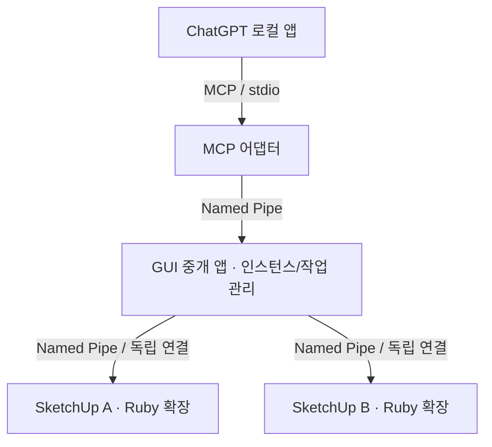

# 연결 구조 및 후속 설계

## 0.4.0 기초 명령 전달

`shared/CommandCatalog.cs`가 변경 도구 5개와 결과 조회 도구를 선언하고 입력을 검증합니다. GUI는 기존 파이프를 통해 Ruby Session으로 라우팅하며, `CommandExecutor`는 패널의 메인 스레드 타이머에서 선택·카메라·객체 속성·이동을 동기 실행합니다. 기존 조회 도구의 권한 규칙은 유지합니다.

변경에는 현재 모델·로컬 실행 허가·lease·편집 경로·유효 기한을 확인합니다. Session의 `next_command_id`는 세션 UUID와 증가하는 번호로 구성됩니다. 최근 결과 32개와 입력 서명을 보관하고, 동일 ID의 같은 내용은 결과만 반환하며 다른 내용이나 만료된 번호는 실행하지 않습니다. 미리보기도 번호를 소비합니다. 모델 전환·GUI 재연결·권한 회수 때 이력을 유지하고 새 Ruby Session은 새 UUID를 사용합니다.

속성·이동은 요청당 한 `start_operation`/`commit_operation`으로 묶고 실패 시 `abort_operation`으로 되돌립니다. 선택·카메라는 모델 Undo 밖에서 이전 상태 복원을 시도합니다. 복원을 확인하지 못하거나 제출 후 통신이 끊겨 결과가 불명확하면 `outcome_unknown`을 반환하며 자동 재시도하지 않습니다. 상세 계약과 실제 앱 검증 상태는 [COMMAND_SCOPE.md](COMMAND_SCOPE.md), [VALIDATION.md](VALIDATION.md)에 있습니다.

## 0.3.0 읽기 전용 조회

공개 MCP 도구 `sketchup_get_model_summary`, `sketchup_get_selection_info`를 추가했습니다. 도구 카탈로그에서 입력과 읽기 전용 특성을 선언하고, GUI가 각각 `get_model_summary`, `get_selection_info`로 라우팅합니다. Ruby Session은 요청 직전 모델 변경을 확인하고 현재 `model_id`와 일치할 때만 ModelReader를 호출합니다. 조회에는 lease나 MCP 작업 허가가 필요하지 않습니다.

ModelReader는 패널의 메인 스레드 타이머 안에서 현재 모델 API를 읽습니다. 하트비트에는 모델 전체 정보를 추가하지 않았으며 요청 시에만 계산합니다. 모델 요약은 루트만 집계하고 최대 개수·시간 제한을 둡니다. 선택 상세는 페이지별로 읽으며 객체 JSON 합계 40 KB와 응답 데이터 60 KB 제한으로 기존 64 KiB 프레이밍을 유지합니다. API 예외나 과대 응답은 조회 오류로 반환하고 파이프를 유지합니다.

숫자 길이는 mm로 통일하고 모델 표시 단위를 별도 반환합니다. 선택 객체의 변환에는 편집 경로 변환과 인스턴스 변환을 합성하며, 정의 축척 전 크기·인스턴스 축 길이·모델 축 외곽 상자를 구별합니다. 세부 계약은 [READ_QUERIES.md](READ_QUERIES.md)에 있습니다.

Windows 통합 검사는 `PROBE_TEST` 빌드에서 `SketchUpCodexMcp.Test.Probe.v1`, `SketchUpCodexMcp.Test.Control.v1`을 사용합니다. Ruby 피어는 `SUPIPE_TEST=1`에서만 시험 파이프를 선택하며 일반 배포의 기본 파이프 이름은 유지합니다. STDIO 실행과 검증은 Python, 실제 Win32 피어 및 상태 머신은 Ruby가 담당합니다.

## 최종 연결 구조

ChatGPT 자체에 Windows Named Pipe 프로토콜을 직접 등록하는 것이 아닙니다. ChatGPT가 지원하는 MCP stdio/Streamable HTTP 중 하나로 어댑터를 연결하고, 자체 프로세스 사이 IPC에 Named Pipe를 사용합니다. 0.2.0에서 로컬 stdio 어댑터를 구현했습니다. 앱의 해당 실행 환경에서 로컬 MCP 도구가 노출되는지는 연결 단계에서 별도 확인합니다.

GUI는 사용자가 실행하고 유지하는 단일 중개 프로세스입니다. MCP 클라이언트가 시작하는 어댑터는 별도 프로세스로 둡니다. MCP 프로세스의 stdout에는 프로토콜 메시지만 기록하고 로그는 stderr/GUI로 보냅니다. 이렇게 하면 MCP 세션이 재시작되어도 SketchUp 연결 관리 UI를 유지할 수 있습니다. 현재 ZIP에 두 실행 파일과 RBZ를 함께 제공합니다. 설치 프로그램은 후속 작업입니다.

## 인스턴스 식별

- `session_id`: 확장 세션의 UUID. 대상 지정에 필수.
- PID: 실제 연결 프로세스 PID를 Windows API로 검증하며 GUI 식별용으로 표시. PID만 영구 식별자로 쓰지 않음.
- `model_id`: 현재 모델 객체의 수명에 맞춘 UUID. 파일 경로가 같거나 미저장 모델이어도 분리.
- `lease`: 해당 모델에 대한 현재 원격 작업 허가 토큰. 사용자 승인이 바뀌거나 연결/모델이 바뀌면 폐기.
- 파일 이름/경로/버전: 사람과 AI의 대상 확인용 정보. 파일 경로 자체를 고유 키로 쓰지 않음.

모델 Save As는 같은 객체라면 `model_id`를 유지하고 표시 경로만 바뀝니다. 다른 모델 객체를 열면 새 토큰을 부여합니다. 사용자 의도에 따라 Save As도 승인 무효화 대상으로 확장할 수 있습니다.

한 인스턴스 안에서는 변경 명령을 직렬화하고, 서로 다른 인스턴스의 작업은 독립적으로 처리합니다. 여러 인스턴스를 하나의 원자적 트랜잭션으로 취급하지 않습니다.

## 제어권 및 중지

초기 상태는 사용자 제어입니다. SketchUp 패널에서만 원격 권한을 허용할 수 있으며, AI나 GUI 요청으로 권한을 자체 획득하지 못하게 합니다. 실제 변경은 Ruby 쪽에서 대상 모델과 권한을 다시 확인합니다.

1. 사용자: 연결 상태/Ping·모델/선택 조회·보관 결과 조회 가능. 변경 작업 거부.
2. MCP 허용: 명시한 모델·유효한 lease로 등록된 작업만 시작.
3. 작업 중: 진행률·현재 단계·취소 버튼 표시. 같은 인스턴스에서 다른 변경 작업 거부.
4. 사용자 회수/연결 해제/모델 전환: 진행 중인 협력적 작업 취소, 대기 작업 폐기, lease 폐기.

현재 시험판은 1~4의 프로토콜 및 변경 실행기를 자동 검사했습니다. 실제 SketchUp 편집 도구 잠금은 구현하지 않았습니다. 운영판에서는 커스텀 Tool을 통한 입력 가드, 모델 변경 감지, 명령 전후 모델 검증을 함께 검토해야 합니다. 선택 도구 교체만으로 메뉴·단축키·다른 확장의 편집까지 완벽히 막는다고 가정하지 않습니다.

실제 모델 편집은 `start_operation`/`commit_operation`/`abort_operation`의 Undo 경계를 설계합니다. 긴 작업은 작은 단위로 나누고, 중단 시 완료된 부분/롤백 여부를 명확히 반환합니다. 타이머 여러 번에 걸친 단일 operation은 다른 사용자/확장 편집이 끼어들 수 있으므로 별도 검증 없이 사용하지 않습니다.

## Named Pipe 구현

파이프: `\\.\pipe\SketchUpCodexMcp.Probe.v1`

GUI가 같은 이름의 여러 서버 인스턴스를 만들고 각 SketchUp이 클라이언트로 연결합니다. 연결당 duplex byte stream. UTF-8 JSON 한 줄을 한 프레임으로 사용합니다. JSON 문자열 속 개행은 이스케이프됩니다. 최대 프레임 64 KiB, 출력 큐 64개, 쓰기 제한 시간 5초. 이미지/큰 모델 데이터는 향후 별도 크기 제한과 스트리밍 규약을 설계합니다.

Ruby는 `Fiddle`과 동봉한 Win32 보조 DLL을 통해 `CreateFileW(FILE_FLAG_OVERLAPPED)`와 `ReadFile`/`WriteFile`/`GetOverlappedResult`를 사용합니다. `OVERLAPPED`와 버퍼는 네이티브 메모리에 유지합니다. 읽기/쓰기마다 별도의 수동 재설정 event를 사용합니다. `CancelIoEx` 호출만으로 메모리를 해제하지 않고 완료가 확인된 후 해제합니다. `WaitNamedPipe`나 무기한 대기는 메인 스레드에서 하지 않습니다.

SketchUp API 호출은 `UI.start_timer`가 호출하는 메인 스레드에 한정합니다. 패널도 상태 머신과 같은 스레드에서 갱신합니다.

### 시험 메시지

| type | 용도 |
|---|---|
| hello / welcome | 버전·세션·PID 등록 / 수락 |
| state | 모델·제어권·진행률·오류 보고 |
| bridge_state | GUI에서 Ruby로 MCP 클라이언트 연결 상태 전달 |
| request | ping, get_state, get_model_summary, get_selection_info, demo, get_job, cancel, release_owner, test_error, set_selection, set_view, zoom, update_entity_properties, move_entities, get_command_result |
| result | 요청 ID에 대응하는 수락/오류/응답 |
| event | 작업 완료/취소 |

모든 메시지에 `v: 1`, `type`, `session_id`가 있습니다. 요청에는 `id`와 `method`, 권한이 필요한 요청에는 `model_id`, `lease`가 추가됩니다. 최근 256개 요청 ID의 중복 실행을 거부합니다. 종료 작업 32개를 Ruby 메모리에 보존합니다. timeout 시 자동 재시도하지 않습니다. 영구 보관은 후속 범위입니다.

## 0.2.0 MCP 어댑터

- MCP 지원 버전: 2025-11-25, 2025-06-18, 2025-03-26. 미지원 버전 요청 시 2025-11-25를 제안합니다.
- `initialize` → `notifications/initialized` → 도구 호출 순서를 적용합니다.
- `tools/list`, `tools/call`, `ping`과 취소 알림을 처리합니다. resources, prompts, sampling, MCP Tasks는 제공하지 않습니다.
- stdout은 JSON-RPC 전용, 진단은 stderr와 GUI 로그로 전달합니다.
- MCP 및 GUI 제어 프레임 최대 1 MiB, SketchUp 프레임 최대 64 KiB. 연결당 동시 도구 호출 최대 16개입니다.
- GUI 제어 파이프: `SketchUpCodexMcp.Control.v1`. 현재 Windows 사용자 ACL 및 Network SID 거부를 적용합니다. 동일 사용자 프로세스 간 강한 인증 격리는 제공하지 않습니다.
- GUI는 어댑터 PID를 Windows API로 확인합니다. 표시되는 MCP 클라이언트 이름은 initialize의 clientInfo이며 인증된 서비스 신원은 아닙니다.
- GUI 제어 프로토콜은 hello/welcome, request/result/cancel입니다. 각 어댑터 연결에 GUI가 owner UUID를 부여합니다.
- SketchUp 호출에는 별도 요청 UUID를 부여해 응답과 연결합니다. 데모 시작 요청 ID가 작업 ID가 됩니다.
- Ruby 응답 제한 8초, 시작 명령 유효기간 7초, 제어 파이프 호출 제한 15초입니다. 시간은 로컬 PC 시계를 기준으로 합니다.
- 취소나 timeout의 정리 요청은 같은 파이프로 정확한 job_id에만 보냅니다. Ruby 타이머가 멈춰 있다면 취소도 지연됩니다.
- 어댑터 연결 종료 시 진행 중 호출을 취소하고, dispatch가 끝난 후 release_owner를 보냅니다. 다른 어댑터 소유 작업은 유지합니다.
- GUI 재연결은 자동이지만 이미 제출된 명령은 다시 보내지 않습니다. --start-gui는 최초 연결 전에 한 번만 실행을 시도합니다.
- 목록 상태는 캐시임을 표시하고, get_instance는 실제 Ruby 응답을 기다립니다.
- 공개 도구에 lease, 임의 Ruby 실행, 권한 부여 명령을 노출하지 않습니다.

## 다음 단계

1. 0.4.0 RBZ를 실제 SketchUp 시험 모델에 설치하고 조회 회귀·명령·중첩 편집 이동·Undo를 검증.
2. 필요에 따른 객체 검색·구조 탐색·화면 캡처.
3. 모델 생성·회전·축척 도구와 편집 충돌 처리의 후속 범위 설계.
4. 설치 프로그램·서명·공개 GitHub Release. 필요할 때 .NET LTS 자체 포함 배포로 이전.

플러그인에서 ChatGPT에 먼저 AI 요청을 보내는 역방향 대화 시작은 이번 범위에서 제외했습니다.

## 공식 근거

- ChatGPT 로컬 MCP 전송: https://learn.chatgpt.com/docs/extend/mcp
- SketchUp 버전별 Ruby/API: https://ruby.sketchup.com/file.ReleaseNotes.html
- HtmlDialog: https://ruby.sketchup.com/UI/HtmlDialog.html
- Ruby 2.5 Fiddle: https://docs.ruby-lang.org/en/2.5.0/Fiddle.html
- Overlapped pipe I/O: https://learn.microsoft.com/en-us/windows/win32/ipc/synchronous-and-overlapped-input-and-output
- CancelIoEx와 버퍼 수명: https://learn.microsoft.com/en-us/windows/win32/api/ioapiset/nf-ioapiset-cancelioex

문서는 구현 근거이며 실제 설치 환경에서의 성공을 대신하지 않습니다.

## 0.1.1: Ruby 2.5 오류 코드 호환 수정

Ruby 2.5의 Fiddle.win32_last_error는 Windows GetLastError 대신 errno를 저장하는 버그가 있습니다. 정상적인 ERROR_IO_PENDING(997)을 0으로 읽어 수신을 실패로 판단하는 경로가 있었습니다. `native/pipe_win32.c`는 각 Windows API 직후 같은 네이티브 호출 안에서 GetLastError를 DWORD 출력 인수에 보존합니다. Ruby는 캐시 대신 그 출력을 사용합니다. GetLastError를 별도 Fiddle 호출로 조회하는 사이에 값이 바뀔 가능성도 피합니다.

보조 DLL은 Windows x64 일반 C ABI이며 Ruby 버전에 연결되지 않습니다. 제공된 빌드는 KERNEL32.dll만 import하며 별도 VC++ 런타임 설치가 필요하지 않습니다. LoadLibraryW를 사용하여 한글 설치 경로도 전달합니다. 0.1.1에서는 GUI와 JSON 프로토콜을 유지한 채 이 오류 코드 경로만 수정했습니다. 0.2.0에도 같은 DLL을 사용합니다.

근거: https://github.com/ruby/fiddle/blob/master/NEWS.md (1.0.9 수정 이력), https://blade.ruby-lang.org/ruby-core/71040
